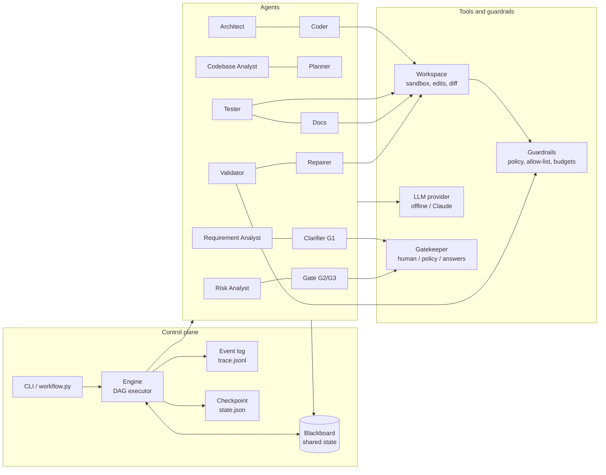
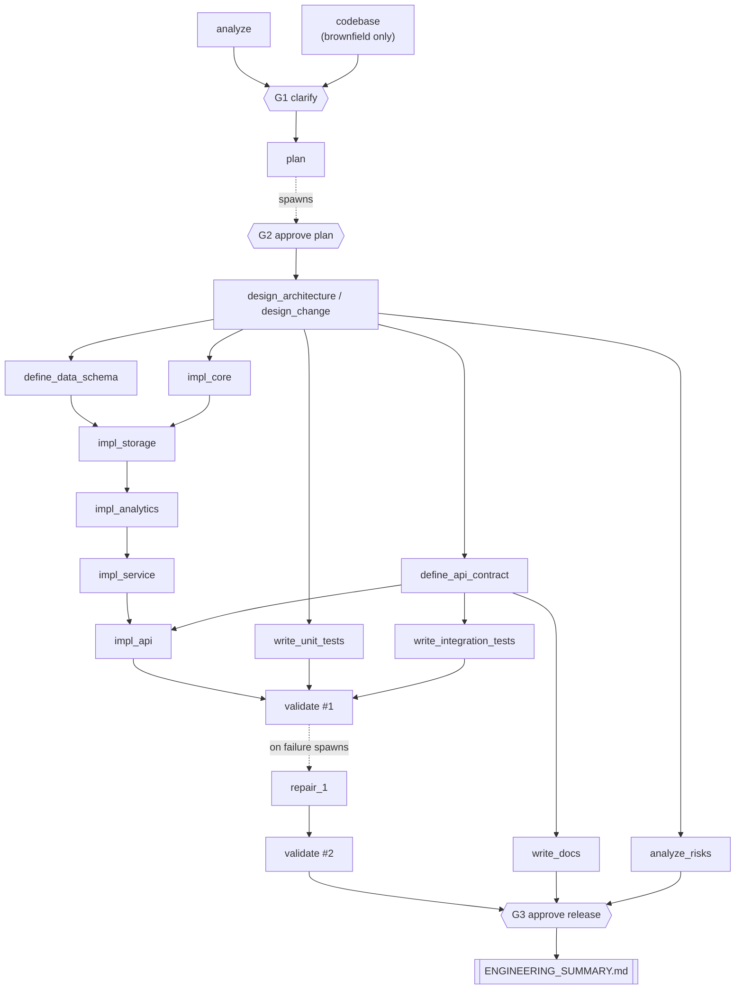

# Architecture

## 1. Components

| Component | Responsibility |
|---|---|
| **Engine** (`orchestrator/engine.py`) | Runs the task graph: dispatches every ready task to a thread pool, enforces output contracts, applies files through the workspace, merges outputs into the blackboard, adds spawned tasks, retries with backoff, propagates failures, checkpoints |
| **TaskGraph** (`orchestrator/dag.py`) | Dependency validation (unknown deps, cycles), readiness, wave computation, transitive blocking, hand-off rewiring, Mermaid export |
| **Blackboard** (`orchestrator/blackboard.py`) | Thread-safe, versioned, attributed shared state: the only way agents coordinate |
| **Agents** (`agents/*`) | Stateless specialists: read the blackboard, do one job, return an `AgentResult` (outputs, files, edits, spawned tasks, hand-off) |
| **Workspace** (`workspace.py`) | Sandboxed file tree per run; brownfield copy plus pristine baseline; atomic anchored edits; unified diff |
| **Guardrails** (`guardrails.py`) | Path sandbox, generated-code policy scan, secret scan, command allow-list with timeout and scrubbed env, budgets |
| **Gatekeeper** (`hitl.py`) | G1/G2/G3 decisions: interactive, policy (auto) or answers file; audit trail |
| **LLM providers** (`llm/`) | `OfflineProvider` (deterministic strategies) and `AnthropicProvider` (Messages API over stdlib HTTPS, transport retries, call budget) |
| **Knowledge** (`knowledge/`) | Analysis rules, the URL-shortener blueprint (Jinja templates parameterized by spec options), the brownfield recipe |
| **Reporter** (`reporter.py`) | Builds the engineering summary (Markdown + JSON) from graph, blackboard, events and audit |

### Agents

| Agent | Reads (blackboard) | Produces | Notes |
|---|---|---|---|
| `analyst` | raw requirement | `spec` | Type, domain, functional/NFR/out-of-scope, acceptance criteria, ambiguities (severity + options + default) |
| `codebase_analyst` | the repo copy | `codebase`, `impact` | Runs **in parallel** with the analyst |
| `clarifier` | `spec` | `spec` (resolved) | Gate G1; folds answers into design `options` and `assumptions`; halts on unanswered HIGH ambiguities |
| `planner` | `spec`, `impact`, `codebase` | `plan` + **spawned tasks** | Validates the candidate DAG before spawning; everything hangs off `approve_plan` |
| `architect` | `spec`, `impact` | `architecture`, `api_contract` + `api/openapi.json`, `data_schema` + `schema.sql`, `change_design` | |
| `coder` | `spec`, `architecture`, `api_contract`, `data_schema`, `change_design` | files or anchored edits | **Refuses code that disagrees with the contract or schema** |
| `tester` | `spec`, `api_contract`, `change_design` | test files, `contract_coverage` | Runs in parallel with coding (tests come from the design, not the code) |
| `docs` | `architecture`, `api_contract` | docs / README edits | |
| `risk` | `spec`, `architecture`, `impact` | `risks` (risks, trade-offs, failure scenarios) | Non-critical: its failure does not block release |
| `validator` | workspace, `api_contract`, `baseline_results` | `validation`, `validation_history` (+ spawns repair) | Deterministic in every mode |
| `repairer` | `validation`, workspace | fixed files / edits | May not modify `tests/` or `api/` |
| `gate` | `spec`, `plan`, `validation`, diff | `gate_plan`, `gate_release` | G2 and G3 as graph nodes |

## 2. Execution model and control flow

### Initial graph, extended at runtime

The actual waves for the URL shortener (from the run report):
`{design_architecture}` → `{analyze_risks, define_api_contract, define_data_schema, impl_core, write_unit_tests}` →
`{impl_storage, write_docs, write_integration_tests}` → `{impl_analytics}` → `{impl_service}` → `{impl_api}` → `{validate}` → `{approve_release}`.

### Engine loop

1. Submit every `PENDING` task whose dependencies are `DONE` (or are non-critical and failed), up to `--workers`.
2. When a task finishes:
   - **success**: check that it published the blackboard keys it promised (output contract), write its
     files/edits through the guarded workspace, merge its outputs, add spawned tasks. If it handed off,
     rewire the pending dependents to wait on the new task. Re-validate the graph and checkpoint.
   - **failure**: retriable errors go back to `PENDING` with exponential backoff, and the agent sees
     `task.error` on its next attempt. `NonRetriableError` (gate rejected, sandbox escape, validation
     budget exhausted, clarification needed) fails at once. A failed critical task **transitively blocks**
     its dependents while independent branches continue.
3. When nothing is runnable, leftover tasks are marked `SKIPPED`, and `finalize` always writes the report,
   whatever the outcome.

### Cross-step coordination (beyond sequencing)

- **Contract-first:** the architect publishes `api_contract`. The coder checks that its `ROUTES` table
  equals the contract (statically, via AST) before handing back the API. The tester derives contract
  coverage from it. The validator checks implementation == contract == `api/openapi.json` on disk, and
  the generated `test_contract.py` checks response bodies against the contract schemas.
- **Schema-first:** the architect writes `schema.sql`. The storage coder verifies the file exists and
  uses every table. The repository loads the DDL at runtime.
- **Tests from design, not code:** test tasks depend on the design and contract, not on the
  implementation, so they run in parallel with coding and act as an independent oracle.
- **Validation hand-off:** a failing `validate` spawns `repair_k → validate_{k+1}` and hands over its
  dependents, so G3 always waits for the *final* verdict.
- **Baseline comparison (brownfield):** `baseline_tests` runs the untouched suite in parallel with the
  implementation, and the validator's regression check compares test by test.

### Controlled autonomy

| Gate | When | Decides | If not approved |
|---|---|---|---|
| G1 clarify | after analysis | answers to ambiguities | HIGH-severity questions unanswered → run stops with `CLARIFICATION_REQUEST.md` (exit 3); resume with answers |
| G2 plan | after planning | spec + assumptions + task graph | all engineering work stays blocked (exit 4) |
| G3 release | after final validation | the diff/artifacts plus validation evidence | nothing released, no patch exported (exit 4) |

Modes: `interactive` (terminal prompts; only medium/high questions are asked, low ones take their
defaults), `auto` (policy: approve G2/G3, take defaults for low/medium, **never guess on high**
unless `--accept-defaults`), and answers file (reproducible, CI-friendly). Every decision is recorded
with who made it.

### Guardrails

| Layer | Mechanism |
|---|---|
| Filesystem | All writes resolved inside `runs/<id>/workspace`; absolute paths, `..`, `.git`, `.env`, `.ssh` rejected (non-retriable). The brownfield repo is copied; the original is never written; changes leave as a patch |
| Generated code | AST scan rejects `eval/exec/__import__`, `os.system/popen`, `subprocess.*`, `shell=True`, `pickle/marshal` loads, `yaml.load`, `shutil.rmtree`; regex secret scan (cloud keys, API keys, private keys, hard-coded passwords). Applied on every write and again by the validator |
| Edits | Anchored search/replace: each anchor must match exactly once; all edits in a batch are checked before any is applied (atomic) |
| Execution | Allow-listed commands only (`python -m pytest`, `ruff check`, ...), no shell, timeout, env scrubbed of `*KEY*/*TOKEN*/*SECRET*` |
| Repair | Repairer may not touch `tests/` or `api/`; repair iterations capped (default 3) |
| Budgets | LLM call cap, file count cap, file size cap |

## 3. Key design decisions

| Decision | Alternatives | Why |
|---|---|---|
| **DAG + blackboard** instead of agent-to-agent chat | Conversational multi-agent; linear chain | Explicit dependencies give parallelism, deterministic ordering, clear failure blast radius and resumability. A blackboard makes every handoff inspectable and attributed |
| **Planner spawns tasks into the live graph** | Two separate graphs (plan then execute) | One execution model and one trace. The plan gate is just a node, and repair loops use the same mechanism |
| **Validator is deterministic, even in LLM mode** | LLM-as-judge | Correctness is decided by running things (tests, contract diff, lint, policy), not by opinion. LLMs generate; tools verify |
| **Tests derived from design/contract, in parallel with code** | Generate tests from the implementation | Avoids tests that merely mirror the code's bugs; also shortens the critical path |
| **Repairer cannot edit tests or contract** | Let it fix anything | Prevents "make the test pass by weakening the test" |
| **Offline blueprints + LLM strategies behind one interface** | LLM only | Reproducible demo and CI without credentials; the orchestration, guardrails and validation are identical in both modes |
| **Stdlib-only generated service** | FastAPI + Postgres + Redis | Runs anywhere for evaluation; layering keeps the swap local (documented scaling path) |
| **Anchored edits for brownfield** | Whole-file rewrites; line-number patches | Minimal diffs, fail loudly on drift, safe under concurrent edits to different files |
| **Halt on high-severity ambiguity** | Always guess | A wrong guess on "is it a URL shortener?" or "are user accounts in scope?" wastes the whole run; the system asks precise questions instead |

## 4. Run state and observability

- `trace.jsonl`: every event (task start/done/retry/failed/blocked/spawned, gate decisions, validation
  iterations, guardrail hits) with timestamps.
- `state.json`: checkpoint after every task (graph, blackboard, history, audit, manifest). `--resume`
  re-runs everything not `DONE`.
- `summary.json`: everything in the report, machine-readable.
- Blackboard history: which task wrote which key, in which version.
