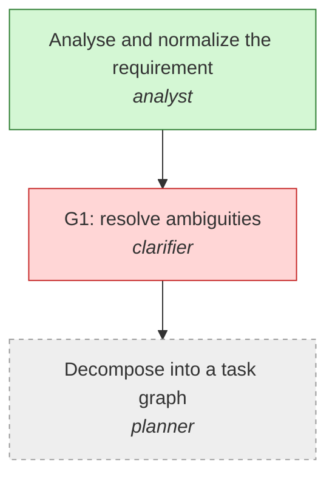

# Engineering Summary: URL shortener service

**Outcome:** ⏸ NEEDS CLARIFICATION  
**Requirement:** We need a links thing that's fast and has some stats. Maybe users too?  
**Run:** `ambiguous` · type `greenfield` · domain `url_shortener` · LLM `offline` (0 calls) · approval mode `auto` · 0.0s

> Stopped at G1: 3 blocking question(s). See CLARIFICATION_REQUEST.md.

## 1. Normalized engineering problem

**Intent:** Let clients turn long URLs into short codes that redirect, persist them durably, and report how links are used.

**Functional requirements**
- Create a short link for a valid http(s) URL via REST API
- Redirect GET /{code} to the target URL
- Fetch and delete link metadata via REST API
- Record clicks and expose per-link analytics
- Persist links and analytics durably across restarts

**Non-functional requirements**
- Redirect hot path does no synchronous writes (analytics are asynchronous)
- Short codes are non-sequential and not enumerable
- Horizontally scalable stateless API tier; storage behind a repository interface
- Consistent JSON error model; no internal details leaked on errors
- Input validation on every external field (URL scheme, length, body size)

**Out of scope**
- User accounts / authentication (documented as a follow-up)
- Web UI
- Link previews / malware scanning (documented as a risk)

**Acceptance criteria**
- [ ] POST /api/v1/links returns 201 with code and short_url for a valid URL, 400 for an invalid one
- [ ] GET /{code} returns 302 with Location for a known code and 404 for an unknown one
- [ ] Creating many links concurrently yields unique codes and never overwrites an existing link
- [ ] Click counts reported by the stats endpoint equal the number of redirects served
- [ ] Every route in the implementation is documented in the OpenAPI contract and vice versa

## 2. Ambiguities and how they were resolved

| id | severity | question | resolution | by |
|---|---|---|---|---|
| system | high | Is the system a URL shortener (create short codes that redirect to long URLs)? | **UNRESOLVED** | - |
| scale | medium | What load should the design target? | **UNRESOLVED** | - |
| performance | medium | What does 'fast' mean for redirects? | **UNRESOLVED** | - |
| analytics | high | Which analytics are required? | **UNRESOLVED** | - |
| users | high | Are user accounts (sign-up, login, per-user link ownership) in scope for this iteration? | **UNRESOLVED** | - |
| custom_alias | low | Should clients be able to choose a custom alias? | **UNRESOLVED** | - |
| expiry | low | Should links support an optional expiry? | **UNRESOLVED** | - |
| rate_limit | low | Should link creation be rate limited to prevent abuse? | **UNRESOLVED** | - |

## 4. Implementation plan and execution

Tasks were decomposed by the Planner into a dependency graph and executed by the orchestrator; independent tasks in the same wave ran in parallel. Dynamic tasks (repair loops) were spawned at runtime.

| task | agent | status | attempts | duration (s) | depends on | spawned by |
|---|---|---|---|---|---|---|
| analyze | analyst | done | 1 | 0.0 | - | - |
| clarify | clarifier | failed | 1 | 0.0 | analyze | - |
| plan | planner | blocked | 0 | - | clarify | - |

**Parallel waves:** {analyze} → {clarify} → {plan}

**Error handling and recovery events**
- `0.003s` clarify FAILED after 1 attempt(s): ClarificationHalt: 3 blocking question(s) need a human answer
- `0.003s` plan blocked by failure of clarify

## 9. Human oversight (audit trail)

| gate | decision | by | comment |
|---|---|---|---|
| clarify:scale | 1k creates/s, 50k redirects/s at peak (design target); 100M links/year | default | - |
| clarify:performance | p99 redirect latency < 50 ms (server side) with cache | default | - |
| clarify:custom_alias | yes | default | - |
| clarify:expiry | yes | default | - |
| clarify:rate_limit | yes | default | - |
| clarify | halted | policy | 3 blocking question(s) unanswered |

**Guardrails active:** workspace sandbox (no writes outside the run directory; original repo never modified), generated-code policy scan (eval/exec/shell/unsafe deserialisation/secrets), allow-listed test execution with timeout and scrubbed credentials, repairer may not edit tests or contract, budgets (max 3 repair iterations, 120 LLM calls, 200 files).

## 10. Assumptions and limitations

**Assumptions**

**Limitations**
- Offline mode: agents use deterministic strategies and domain blueprints (URL shortener, the bundled brownfield sample). Other domains/repositories need `--llm anthropic`.
- Generated service uses SQLite and an in-process cache/queue: correct and tested, but not the production stack for the stated scale target (see scaling path).
- No authentication/authorization on the API (documented risk).
- Load/performance targets are design targets; no load test is executed by the pipeline.
- Validation proves the generated tests pass and the contract matches; it cannot prove the tests are exhaustive - human review at G3 remains essential.

