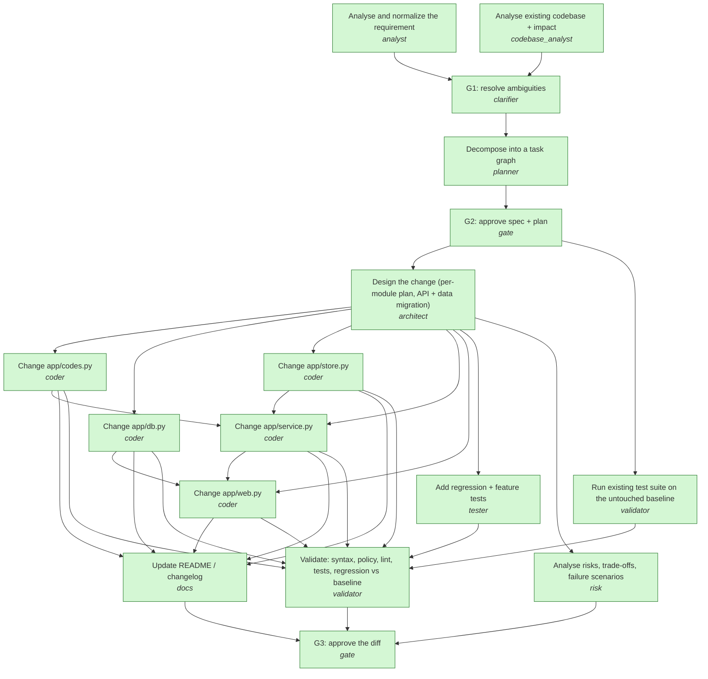

# Engineering Summary: Add optional link expiration: clients can pass ttl_seconds...

**Outcome:** ✅ SUCCESS  
**Requirement:** Add optional link expiration: clients can pass ttl_seconds when shortening and expired links must return HTTP 410. Also fix the bug where a newly generated code can silently overwrite an existing link.  
**Run:** `brownfield` · type `brownfield` · domain `existing_codebase` · LLM `offline` (0 calls) · approval mode `auto` · 0.69s

> Validated change exported as changes.patch; the original repository was not modified.

## 1. Normalized engineering problem

**Intent:** Add optional link expiration: clients can pass ttl_seconds when shortening and expired links must return HTTP 410. Also fix the bug where a newly generated code can silently overwrite an existing link.

**Functional requirements**
- Add optional link expiration: clients can pass ttl_seconds when shortening and expired links must return http 410
- Fix the bug where a newly generated code can silently overwrite an existing link

**Non-functional requirements**
- No regression in existing behaviour (existing tests must keep passing)
- Changes are minimal, localized and follow existing code conventions

**Out of scope**
- Unrelated refactoring

**Acceptance criteria**
- [ ] Add optional link expiration: clients can pass ttl_seconds when shortening and expired links must return http 410 is implemented and covered by an automated test
- [ ] Fix the bug where a newly generated code can silently overwrite an existing link is implemented and covered by an automated test

## 2. Ambiguities and how they were resolved

| id | severity | question | resolution | by |
|---|---|---|---|---|
| compat | low | Must existing API behaviour and stored data stay backward compatible? | yes: additive, backward-compatible change with migration | default |
| ttl_bounds | low | What TTL range is valid? | 1 second to 10 years, integer seconds | default |

## 3. Codebase reasoning (brownfield impact analysis)

**Entry points:** app/web.py  
**APIs touched:** /shorten (app/web.py)  
**Data stores:** links

**Data flows**
- `app/web.py -> app/__init__.py`
- `app/web.py -> app/db.py`
- `app/web.py -> app/service.py -> app/__init__.py`
- `app/web.py -> app/service.py -> app/codes.py`
- `app/web.py -> app/service.py -> app/store.py`

**Impacted modules** (implementation order: data layer first)
| module | confidence | why | symbols |
|---|---|---|---|
| app/codes.py | medium | direct match on code, new_code | new_code |
| app/db.py | high | direct match on code, created, link, links, url | - |
| app/store.py | high | direct match on code, created, insert, link, links, replace | save_link, get_url |
| app/service.py | high | direct match on code, link, links, resolve, shortening, url | resolve |
| app/web.py | high | direct match on app, code, environ, start_response, status | app |

**Tests covering impacted code:** tests/test_service.py

**Risk hotspots found by static analysis**
- `app/db.py:14` SQLite connection shared across threads without a lock: `conn = sqlite3.connect(path, check_same_thread=False)`
- `app/store.py:7` INSERT OR REPLACE silently overwrites existing rows on key conflict: `"INSERT OR REPLACE INTO links (code, url, created) VALUES (?, ?, ?)",`
- `app/web.py:11` module-level mutable global state: `global CONN`

**Change design**
- `app/codes.py`: no change expected; collisions are handled by the caller
- `app/db.py`: add nullable expires_at column; idempotent forward migration for existing databases
- `app/store.py`: replace INSERT OR REPLACE with strict INSERT; raise DuplicateCode on conflict; persist and return expires_at
- `app/service.py`: validate ttl; compute expires_at; reject expired links on resolve; retry code generation on DuplicateCode with a bounded number of attempts
- `app/web.py`: accept optional ttl_seconds; map expired links to the agreed status code
- API changes: POST /shorten: new optional field ttl_seconds (1 second to 10 years, integer seconds); GET /<code>: expired -> 410 Gone
- Data migration: additive nullable column, applied automatically on connect; no backfill needed
- Compatibility: backward compatible: existing requests/responses unchanged, old databases migrate in place

## 4. Implementation plan and execution

Tasks were decomposed by the Planner into a dependency graph and executed by the orchestrator; independent tasks in the same wave ran in parallel. Dynamic tasks (repair loops) were spawned at runtime.

| task | agent | status | attempts | duration (s) | depends on | spawned by |
|---|---|---|---|---|---|---|
| analyze | analyst | done | 1 | 0.001 | - | - |
| codebase | codebase_analyst | done | 1 | 0.005 | - | - |
| clarify | clarifier | done | 1 | 0.001 | analyze, codebase | - |
| plan | planner | done | 1 | 0.001 | clarify | - |
| approve_plan | gate | done | 1 | 0.0 | plan | plan |
| design_change | architect | done | 1 | 0.002 | approve_plan | plan |
| baseline_tests | validator | done | 1 | 0.354 | approve_plan | plan |
| impl_codes | coder | done | 1 | 0.007 | design_change | plan |
| impl_db | coder | done | 1 | 0.003 | design_change | plan |
| impl_store | coder | done | 1 | 0.005 | design_change | plan |
| impl_service | coder | done | 1 | 0.005 | design_change, impl_codes, impl_store | plan |
| impl_web | coder | done | 1 | 0.002 | design_change, impl_db, impl_service | plan |
| update_tests | tester | done | 1 | 0.004 | design_change | plan |
| update_docs | docs | done | 1 | 0.001 | impl_codes, impl_db, impl_store, impl_service, impl_web | plan |
| analyze_risks | risk | done | 1 | 0.005 | design_change | plan |
| validate | validator | done | 1 | 0.31 | impl_codes, impl_db, impl_store, impl_service, impl_web, update_tests, baseline_tests | plan |
| approve_release | gate | done | 1 | 0.002 | validate, update_docs, analyze_risks | plan |

**Parallel waves:** {analyze, codebase} → {clarify} → {plan} → {approve_plan} → {baseline_tests, design_change} → {analyze_risks, impl_codes, impl_db, impl_store, update_tests} → {impl_service} → {impl_web} → {update_docs, validate} → {approve_release}

## 6. Generated artifacts

Location: `workspace/`

| file | produced by | bytes |
|---|---|---|
| README.md | update_docs | 658 |
| app/db.py | impl_db | 696 |
| app/service.py | impl_service | 1654 |
| app/store.py | impl_store | 992 |
| app/web.py | impl_web | 1694 |
| tests/test_expiry_and_collisions.py | update_tests | 3775 |

**Patch for human review:** `changes.patch` (apply with `git apply`)

## 7. Validation

**Strategy:** independent validator re-checks the full tree each iteration: syntax → policy guardrails → lint → API contract conformance → unit + integration tests → regression against baseline. Failures spawn a bounded repair loop; the release gate waits for the final verdict.

| iteration | result | syntax | policy | lint | tests | regression |
|---|---|---|---|---|---|---|
| 1 | PASS | ✔ 8 files parse | ✔ no forbidden constructs or secrets | ✔ ruff F,E9 clean | ✔ 17/17 passed | ✔ 3 baseline tests still pass |

**Baseline (before change):** 3/3 tests passing

## 8. Risks, trade-offs and failure scenarios

| risk | category | likelihood | impact | mitigation |
|---|---|---|---|---|
| Pre-existing issue in app/db.py:14: SQLite connection shared across threads without a lock | reliability | medium | medium | Out of scope; flagged for follow-up |
| Pre-existing issue in app/store.py:7: INSERT OR REPLACE silently overwrites existing rows on key conflict | reliability | medium | high | Fixed by this change |
| Pre-existing issue in app/web.py:11: module-level mutable global state | reliability | medium | medium | Out of scope; flagged for follow-up |
| Schema migration on live databases | data | low | high | Additive nullable column, idempotent, tested against a v1 database; take a backup before deploy. |
| Callers relying on old store.get_url signature | delivery | low | medium | Kept get_url as a backward-compatible wrapper; new code uses get_link. |
| Clock skew across instances affects expiry | reliability | low | low | Expiry uses server time at resolve; acceptable at second-level TTL granularity. |

**Trade-offs**
| choice | gain | cost |
|---|---|---|
| Retry on collision vs longer codes | keeps existing 5-char code format | bounded retries; code space (26^5 ~ 11.9M) will need longer codes as volume grows |
| 410 Gone for expired links | clients can distinguish expired from unknown | reveals that a code once existed |

**Failure scenarios and designed behaviour**
| scenario | behaviour |
|---|---|
| Code space nearly exhausted | 503 after MAX_CODE_ATTEMPTS; monitor and increase CODE_LENGTH |
| Old database without expires_at | migrated in place on first connect |

## 9. Human oversight (audit trail)

| gate | decision | by | comment |
|---|---|---|---|
| clarify:compat | yes: additive, backward-compatible change with migration | default | - |
| clarify:ttl_bounds | 1 second to 10 years, integer seconds | default | - |
| plan | approved | auto-policy | non-interactive run; approval delegated to policy |
| release | approved | auto-policy | non-interactive run; approval delegated to policy |

**Guardrails active:** workspace sandbox (no writes outside the run directory; original repo never modified), generated-code policy scan (eval/exec/shell/unsafe deserialisation/secrets), allow-listed test execution with timeout and scrubbed credentials, repairer may not edit tests or contract, budgets (max 3 repair iterations, 120 LLM calls, 200 files).

## 10. Assumptions and limitations

**Assumptions**
- Assumed (default): Must existing API behaviour and stored data stay backward compatible? -> yes: additive, backward-compatible change with migration
- Assumed (default): What TTL range is valid? -> 1 second to 10 years, integer seconds

**Limitations**
- Offline mode: agents use deterministic strategies and domain blueprints (URL shortener, the bundled brownfield sample). Other domains/repositories need `--llm anthropic`.
- Validation proves the generated tests pass and the contract matches; it cannot prove the tests are exhaustive - human review at G3 remains essential.

