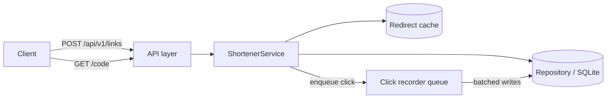

# Architecture

**Style:** layered service (API -> service -> repository), async analytics pipeline

## Components
| Component | Module | Responsibility |
|---|---|---|
| API layer (WSGI) | `shortener/api.py` | routing, JSON (de)serialisation, error mapping, request ids, per-client rate limiting |
| ShortenerService | `shortener/service.py` | business rules: validation, code allocation with collision retry, custom aliases, expiry, redirect resolution |
| Code generator | `shortener/idgen.py` | random base62 codes (non-enumerable, coordination-free) |
| Repository (SQLite) | `shortener/storage/sqlite_repo.py` | persistence behind a LinkRepository protocol; swappable for PostgreSQL |
| Redirect cache | `shortener/cache.py` | TTL+LRU cache for the read-heavy redirect path |
| Click recorder | `shortener/analytics.py` | async, batched, load-shedding click ingestion off the hot path |

## Key decisions
### Random 7-char base62 codes + unique constraint + retry
- **Alternatives:** global counter + base62; hash(url) truncation
- **Why:** No single coordinator, codes are not guessable, collisions are ~1e-12 per insert at 1M links and handled by retry. Counter needs a sequence service; hashing makes duplicates/collisions deterministic.

### Analytics written asynchronously in batches
- **Alternatives:** synchronous insert per redirect; external queue (Kafka) + stream processor
- **Why:** Keeps redirect latency independent of write load. In-process queue is the simplest step; the ClickRecorder interface is where a Kafka/Kinesis producer plugs in at scale.

### 302 (temporary) redirects with Cache-Control: private, max-age=0
- **Alternatives:** 301 permanent redirects
- **Why:** 301 is cached by browsers so later clicks are never counted and links cannot be re-pointed or expired; 302 preserves analytics accuracy at the cost of extra requests.

### Standard-library WSGI + SQLite for the prototype
- **Alternatives:** FastAPI + PostgreSQL + Redis
- **Why:** Zero dependencies so reviewers can run it anywhere. Layering (API -> service -> repository protocol) keeps the swap to Postgres/Redis local to two modules.

### Denormalized click_count on links plus raw click_events
- **Alternatives:** aggregate on read only
- **Why:** O(1) total-click reads; detailed roll-ups come from an indexed events table.

## Data model
- **links**: code PK, target_url, created_at, expires_at, is_custom, click_count, last_click_at
- **click_events**: id PK, code FK->links ON DELETE CASCADE, occurred_at, day, referrer_host, user_agent

Schema: `shortener/storage/schema.sql`.

## Request flow (redirect)
1. API matches `/{code}` and calls `ShortenerService.resolve`.
2. Cache hit returns the link; on miss the repository is read and the cache filled.
3. Expired links raise `Gone` (410).
4. A `ClickEvent` is enqueued (no I/O) and the API returns `302` with `Location`.
5. The background recorder flushes events in batches and updates counters.

## Scaling path
- Stateless API instances behind a load balancer; scale horizontally.
- Move storage to PostgreSQL (primary + read replicas); shard links by hash(code) beyond ~1B rows.
- Shared Redis cache in front of the DB for redirects (>95% hit rate expected on popular links).
- Replace the in-process click queue with Kafka; aggregate with a stream job into an OLAP store.
- CDN/edge redirects for the hottest codes; keep 302 semantics for analytics accuracy.

Design target: 1k creates/s, 50k redirects/s at peak (design target); 100M links/year.
