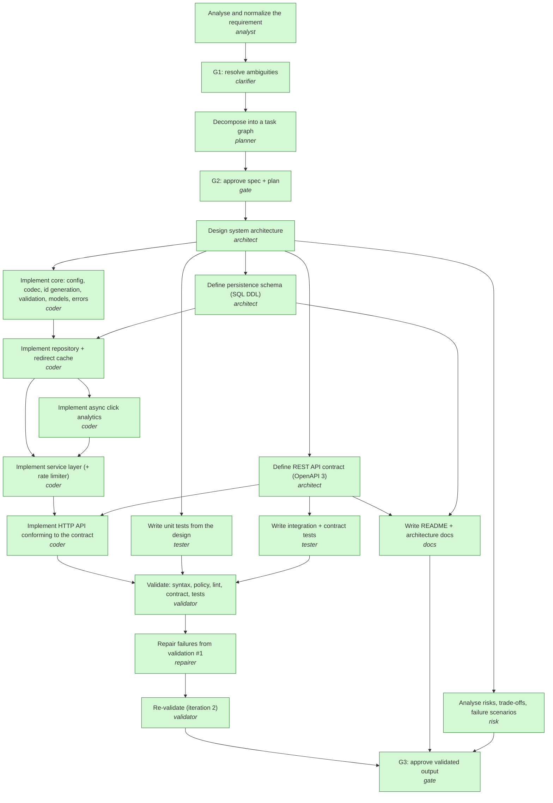

# Engineering Summary: URL shortener service

**Outcome:** ✅ SUCCESS  
**Requirement:** Build a scalable URL shortener service with APIs, persistence, and analytics.  
**Run:** `recovery` · type `greenfield` · domain `url_shortener` · LLM `offline` (0 calls) · approval mode `auto` · 5.87s

> Generated project is in workspace/ (cd there and run `python -m pytest`).

## 1. Normalized engineering problem

**Intent:** Let clients turn long URLs into short codes that redirect, persist them durably, and report how links are used.

**Functional requirements**
- Create a short link for a valid http(s) URL via REST API
- Redirect GET /{code} to the target URL
- Fetch and delete link metadata via REST API
- Record clicks and expose per-link analytics
- Persist links and analytics durably across restarts

**Non-functional requirements**
- Redirect hot path does no synchronous writes (analytics are asynchronous)
- Short codes are non-sequential and not enumerable
- Horizontally scalable stateless API tier; storage behind a repository interface
- Consistent JSON error model; no internal details leaked on errors
- Input validation on every external field (URL scheme, length, body size)
- Scale target: 1k creates/s, 50k redirects/s at peak (design target); 100M links/year

**Out of scope**
- User accounts / authentication (documented as a follow-up)
- Web UI
- Link previews / malware scanning (documented as a risk)

**Acceptance criteria**
- [ ] POST /api/v1/links returns 201 with code and short_url for a valid URL, 400 for an invalid one
- [ ] GET /{code} returns 302 with Location for a known code and 404 for an unknown one
- [ ] Creating many links concurrently yields unique codes and never overwrites an existing link
- [ ] Click counts reported by the stats endpoint equal the number of redirects served
- [ ] Every route in the implementation is documented in the OpenAPI contract and vice versa

## 2. Ambiguities and how they were resolved

| id | severity | question | resolution | by |
|---|---|---|---|---|
| scale | medium | What load should the design target? | 1k creates/s, 50k redirects/s at peak (design target); 100M links/year | default |
| analytics | medium | Which analytics are required? | detailed: total clicks, clicks per day, top referrers | default |
| custom_alias | low | Should clients be able to choose a custom alias? | yes | default |
| expiry | low | Should links support an optional expiry? | yes | default |
| rate_limit | medium | Should link creation be rate limited to prevent abuse? | yes | default |

## 4. Implementation plan and execution

Tasks were decomposed by the Planner into a dependency graph and executed by the orchestrator; independent tasks in the same wave ran in parallel. Dynamic tasks (repair loops) were spawned at runtime.

| task | agent | status | attempts | duration (s) | depends on | spawned by |
|---|---|---|---|---|---|---|
| analyze | analyst | done | 1 | 0.0 | - | - |
| clarify | clarifier | done | 1 | 0.001 | analyze | - |
| plan | planner | done | 1 | 0.001 | clarify | - |
| approve_plan | gate | done | 1 | 0.001 | plan | plan |
| design_architecture | architect | done | 1 | 0.0 | approve_plan | plan |
| define_api_contract | architect | done | 1 | 0.005 | design_architecture | plan |
| define_data_schema | architect | done | 1 | 0.008 | design_architecture | plan |
| impl_core | coder | done | 1 | 0.035 | design_architecture | plan |
| impl_storage | coder | done | 2 | 0.204 | impl_core, define_data_schema | plan |
| impl_analytics | coder | done | 1 | 0.001 | impl_storage | plan |
| impl_service | coder | done | 1 | 0.002 | impl_storage, impl_analytics | plan |
| impl_api | coder | done | 1 | 0.005 | impl_service, define_api_contract | plan |
| write_unit_tests | tester | done | 1 | 0.031 | design_architecture | plan |
| write_integration_tests | tester | done | 1 | 0.018 | define_api_contract | plan |
| write_docs | docs | done | 1 | 0.01 | define_api_contract, define_data_schema | plan |
| analyze_risks | risk | done | 1 | 0.002 | design_architecture | plan |
| validate | validator | done | 1 | 2.803 | impl_api, write_unit_tests, write_integration_tests | plan |
| approve_release | gate | done | 1 | 0.003 | validate_2, write_docs, analyze_risks | plan |
| repair_1 | repairer | done | 1 | 0.005 | validate | validate |
| validate_2 | validator | done | 1 | 2.788 | repair_1 | validate |

**Parallel waves:** {analyze} → {clarify} → {plan} → {approve_plan} → {design_architecture} → {analyze_risks, define_api_contract, define_data_schema, impl_core, write_unit_tests} → {impl_storage, write_docs, write_integration_tests} → {impl_analytics} → {impl_service} → {impl_api} → {validate} → {repair_1} → {validate_2} → {approve_release}

**Error handling and recovery events**
- `0.044s` impl_storage failed (InjectedTransientError: injected transient failure in impl_storage (simulated LLM timeout)); retrying in 0.2s
- `0.258s` impl_api: fault injection planted a defect (validator should catch it)
- `3.065s` validate spawned repair_1 [repairer] Repair failures from validation #1
- `3.065s` validate spawned validate_2 [validator] Re-validate (iteration 2)
- `3.072s` repair_1 done in 0.005s, 1 file(s): implicated components: ['analytics', 'api', 'service', 'storage']; files in tracebacks: none | regenerated 1 changed file(s): ['shortener/api.py']

## 5. Architecture and rationale

**Style:** layered service (API -> service -> repository), async analytics pipeline

| component | module | responsibility |
|---|---|---|
| API layer (WSGI) | shortener/api.py | routing, JSON (de)serialisation, error mapping, request ids, per-client rate limiting |
| ShortenerService | shortener/service.py | business rules: validation, code allocation with collision retry, custom aliases, expiry, redirect resolution |
| Code generator | shortener/idgen.py | random base62 codes (non-enumerable, coordination-free) |
| Repository (SQLite) | shortener/storage/sqlite_repo.py | persistence behind a LinkRepository protocol; swappable for PostgreSQL |
| Redirect cache | shortener/cache.py | TTL+LRU cache for the read-heavy redirect path |
| Click recorder | shortener/analytics.py | async, batched, load-shedding click ingestion off the hot path |

**Key decisions**
| decision | alternatives considered | rationale |
|---|---|---|
| Random 7-char base62 codes + unique constraint + retry | global counter + base62; hash(url) truncation | No single coordinator, codes are not guessable, collisions are ~1e-12 per insert at 1M links and handled by retry. Counter needs a sequence service; hashing makes duplicates/collisions deterministic. |
| Analytics written asynchronously in batches | synchronous insert per redirect; external queue (Kafka) + stream processor | Keeps redirect latency independent of write load. In-process queue is the simplest step; the ClickRecorder interface is where a Kafka/Kinesis producer plugs in at scale. |
| 302 (temporary) redirects with Cache-Control: private, max-age=0 | 301 permanent redirects | 301 is cached by browsers so later clicks are never counted and links cannot be re-pointed or expired; 302 preserves analytics accuracy at the cost of extra requests. |
| Standard-library WSGI + SQLite for the prototype | FastAPI + PostgreSQL + Redis | Zero dependencies so reviewers can run it anywhere. Layering (API -> service -> repository protocol) keeps the swap to Postgres/Redis local to two modules. |
| Denormalized click_count on links plus raw click_events | aggregate on read only | O(1) total-click reads; detailed roll-ups come from an indexed events table. |

**Scaling path**
- Stateless API instances behind a load balancer; scale horizontally.
- Move storage to PostgreSQL (primary + read replicas); shard links by hash(code) beyond ~1B rows.
- Shared Redis cache in front of the DB for redirects (>95% hit rate expected on popular links).
- Replace the in-process click queue with Kafka; aggregate with a stream job into an OLAP store.
- CDN/edge redirects for the hottest codes; keep 302 semantics for analytics accuracy.

## 6. Generated artifacts

Location: `workspace/`

| file | produced by | bytes |
|---|---|---|
| .gitignore | impl_core | 51 |
| Dockerfile | impl_core | 225 |
| api/openapi.json | define_api_contract | 10360 |
| docs/ARCHITECTURE.md | write_docs | 3782 |
| docs/README.md | write_docs | 1986 |
| pyproject.toml | impl_core | 238 |
| shortener/__init__.py | impl_core | 196 |
| shortener/analytics.py | impl_analytics | 2569 |
| shortener/api.py | repair_1 | 7362 |
| shortener/cache.py | impl_storage | 1908 |
| shortener/codec.py | impl_core | 883 |
| shortener/config.py | impl_core | 1166 |
| shortener/errors.py | impl_core | 1131 |
| shortener/idgen.py | impl_core | 868 |
| shortener/models.py | impl_core | 1276 |
| shortener/ratelimit.py | impl_service | 1540 |
| shortener/server.py | impl_api | 1592 |
| shortener/service.py | impl_service | 4391 |
| shortener/storage/__init__.py | impl_storage | 624 |
| shortener/storage/schema.sql | define_data_schema | 1145 |
| shortener/storage/sqlite_repo.py | impl_storage | 5481 |
| shortener/validation.py | impl_core | 1424 |
| tests/conftest.py | write_unit_tests | 2787 |
| tests/integration/test_api.py | write_integration_tests | 3977 |
| tests/integration/test_contract.py | write_integration_tests | 2361 |
| tests/integration/test_http_server.py | write_integration_tests | 2657 |
| tests/unit/test_analytics.py | write_unit_tests | 1691 |
| tests/unit/test_cache.py | write_unit_tests | 983 |
| tests/unit/test_codec_and_idgen.py | write_unit_tests | 928 |
| tests/unit/test_ratelimit.py | write_unit_tests | 798 |
| tests/unit/test_service.py | write_unit_tests | 2781 |
| tests/unit/test_validation.py | write_unit_tests | 1130 |

**API contract** (`api/openapi.json`)
| method | path | summary | responses |
|---|---|---|---|
| GET | /healthz | Liveness/readiness probe | 200 |
| POST | /api/v1/links | Create a short link | 201, 400, 413, 503, 409, 429 |
| GET | /api/v1/links/{code} | Get link metadata | 200, 404 |
| DELETE | /api/v1/links/{code} | Delete a link | 204, 404 |
| GET | /api/v1/links/{code}/stats | Click analytics for a link | 200, 404 |
| GET | /{code} | Redirect to the target URL | 302, 404, 410 |

**Schema:** `shortener/storage/schema.sql` (tables: links, click_events)

## 7. Validation

**Strategy:** independent validator re-checks the full tree each iteration: syntax → policy guardrails → lint → API contract conformance → unit + integration tests. Failures spawn a bounded repair loop; the release gate waits for the final verdict.

| iteration | result | syntax | policy | lint | contract | tests |
|---|---|---|---|---|---|---|
| 1 | FAIL | ✔ 25 files parse | ✔ no forbidden constructs or secrets | ✔ ruff F,E9 clean | ✔ 6 routes match 6 documented operations | ✘ 79/82 passed; failing: test_create_redirect_and_stats_flow, test_full_round_trip_over_http, test_concurrent_creates_and_redirects |
| 2 | PASS | ✔ 25 files parse | ✔ no forbidden constructs or secrets | ✔ ruff F,E9 clean | ✔ 6 routes match 6 documented operations | ✔ 82/82 passed |

**Contract coverage by tests:** 100% of documented operations (uncovered: none)

## 8. Risks, trade-offs and failure scenarios

| risk | category | likelihood | impact | mitigation |
|---|---|---|---|---|
| Abuse for phishing/malware redirects | security | high | high | Rate limiting on creation is in place; add URL reputation checks (e.g. Safe Browsing) and an abuse report/takedown flow before public launch |
| Open, unauthenticated write/delete API | security | high | high | Prototype assumption. Add API keys/OAuth and per-owner authorization before exposure; DELETE must be owner-only. |
| SQLite write contention at the stated scale target | scalability | high | medium | Repository protocol isolates storage; migrate to PostgreSQL (+ read replicas, sharding by code hash). |
| Analytics loss on crash or queue overflow | data | medium | low | Batched flush every 0.5s bounds loss; dropped events are counted and exposed on /healthz; move to Kafka for durable ingestion. |
| Per-instance cache serves stale data after delete | reliability | medium | medium | TTL bounds staleness; deletes invalidate locally; use shared Redis with pub/sub invalidation when running multiple instances. |
| Hot links overload a single DB row (click_count) | scalability | medium | medium | Counter updates are batched per flush; at higher scale use sharded counters or stream aggregation. |
| In-process rate limits are per instance | security | medium | low | Acceptable for prototype; use a shared token bucket (Redis) behind a load balancer. |
| Expired rows accumulate | data | medium | low | Indexed expires_at enables a periodic purge job (not yet implemented). |

**Trade-offs**
| choice | gain | cost |
|---|---|---|
| 302 instead of 301 | accurate analytics, links can expire/be deleted | every click hits the service (no browser caching) |
| Async analytics | redirect latency independent of analytics writes | stats are eventually consistent (pending_events exposed); small loss window on crash |
| Random codes | non-enumerable, coordination-free | requires uniqueness check + retry; slightly longer codes than a counter |
| Stdlib WSGI + SQLite | zero dependencies, trivially runnable | not the production stack; swap required for the scale target |

**Failure scenarios and designed behaviour**
| scenario | behaviour |
|---|---|
| Database unavailable | API returns 500 with generic error; /healthz reports degraded; analytics flush failures are logged and retried next interval |
| Code collision | unique constraint -> retry up to 5 times -> 503 (never overwrites) |
| Traffic spike on one link | served from cache; click queue absorbs bursts, sheds load (counted) when full |
| Malformed / oversized input | 400/413 with stable error shape; no stack traces |

## 9. Human oversight (audit trail)

| gate | decision | by | comment |
|---|---|---|---|
| clarify:scale | 1k creates/s, 50k redirects/s at peak (design target); 100M links/year | default | - |
| clarify:analytics | detailed: total clicks, clicks per day, top referrers | default | - |
| clarify:custom_alias | yes | default | - |
| clarify:expiry | yes | default | - |
| clarify:rate_limit | yes | default | - |
| plan | approved | auto-policy | non-interactive run; approval delegated to policy |
| release | approved | auto-policy | non-interactive run; approval delegated to policy |

**Guardrails active:** workspace sandbox (no writes outside the run directory; original repo never modified), generated-code policy scan (eval/exec/shell/unsafe deserialisation/secrets), allow-listed test execution with timeout and scrubbed credentials, repairer may not edit tests or contract, budgets (max 3 repair iterations, 120 LLM calls, 200 files).

## 10. Assumptions and limitations

**Assumptions**
- Assumed (default): What load should the design target? -> 1k creates/s, 50k redirects/s at peak (design target); 100M links/year
- Assumed (default): Which analytics are required? -> detailed: total clicks, clicks per day, top referrers
- Assumed (default): Should clients be able to choose a custom alias? -> yes
- Assumed (default): Should links support an optional expiry? -> yes
- Assumed (default): Should link creation be rate limited to prevent abuse? -> yes

**Limitations**
- Offline mode: agents use deterministic strategies and domain blueprints (URL shortener, the bundled brownfield sample). Other domains/repositories need `--llm anthropic`.
- Generated service uses SQLite and an in-process cache/queue: correct and tested, but not the production stack for the stated scale target (see scaling path).
- No authentication/authorization on the API (documented risk).
- Load/performance targets are design targets; no load test is executed by the pipeline.
- Validation proves the generated tests pass and the contract matches; it cannot prove the tests are exhaustive - human review at G3 remains essential.

